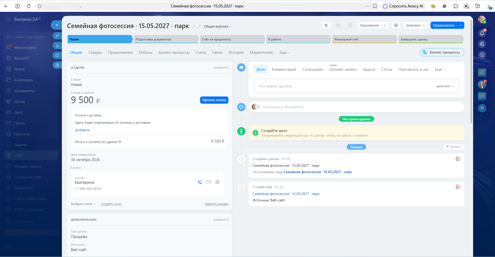
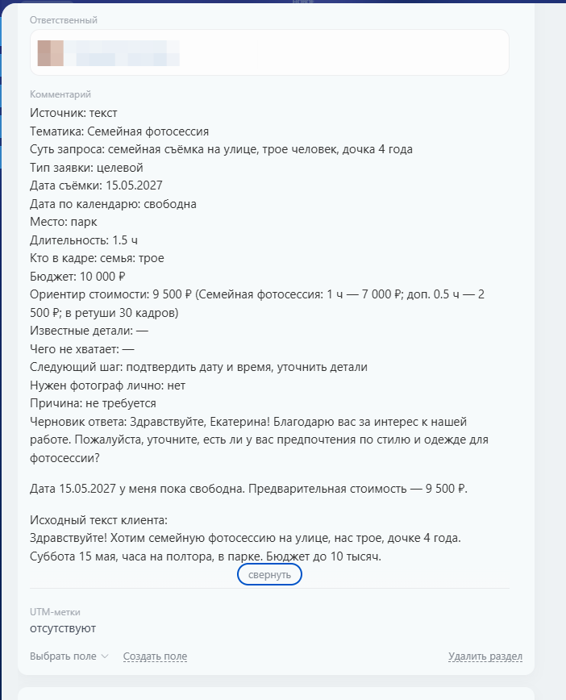
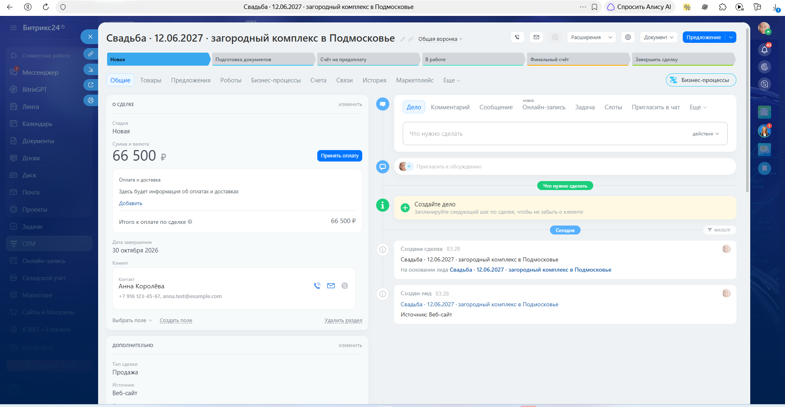
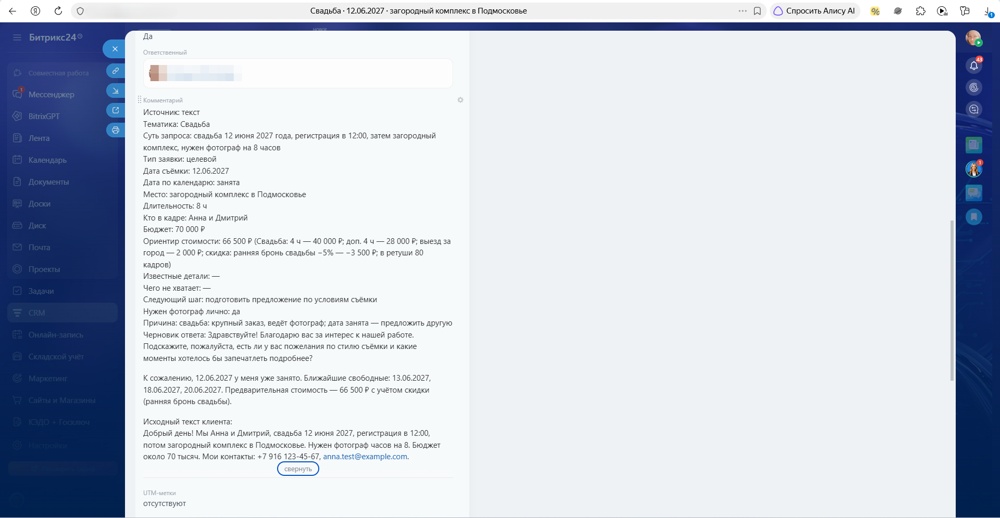
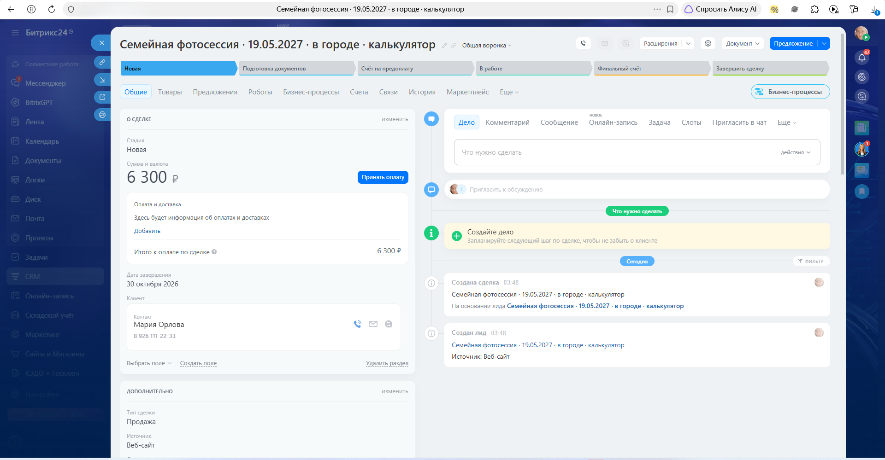
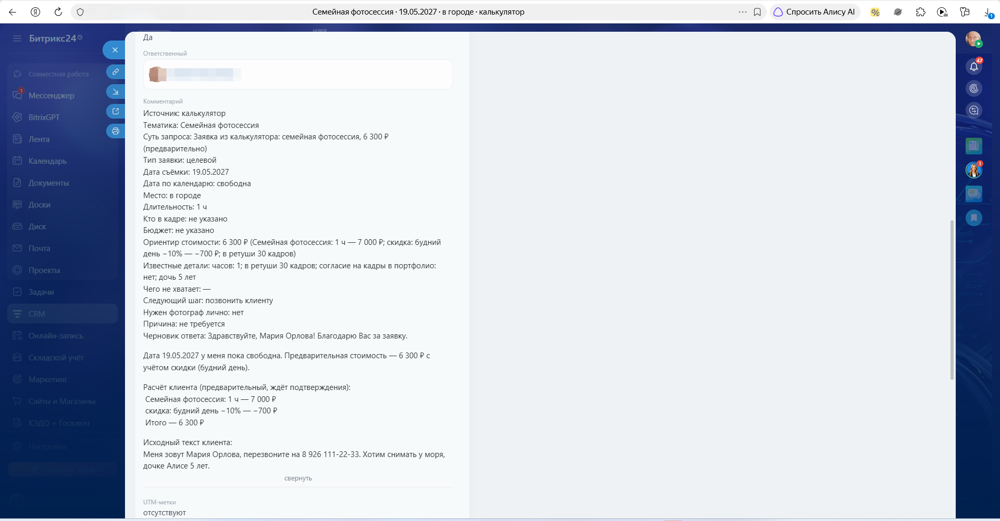
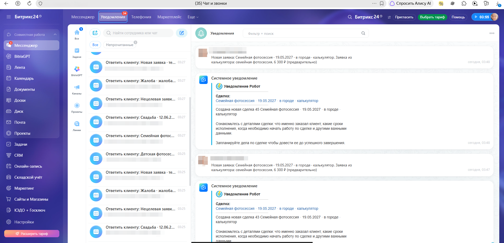

# IK03. Подключаем автоматизацию и доводим MVP — отчёт по ДЗ

| | |
|---|---|
| Интенсив | «Первая ИИ-услуга для бизнеса», Zerocoder |
| Урок | IK03. Подключаем автоматизацию и доводим MVP |
| Кейс | ИИ-разбор заявок частного фотографа в России (фотограф вымышленный, данные синтетические) |
| Репозиторий | [JaneEva08/photographer-leads-ai-bitrix24](https://github.com/JaneEva08/photographer-leads-ai-bitrix24) |
| Среда разработки | Claude Code (вместо OpenCode) |
| Нейросеть | GigaChat API |
| CRM | Битрикс24, входящий вебхук с правами `crm`, `task`, `im` |
| Дата прогона | 23.10.2026 |

> Я не новичок: уже год прохожу курсы в Zerocoder. На интенсив пошла, потому что понравилась тема: консалтинговый подход «от боли бизнеса к решению» и российский стек (GigaChat, Битрикс24, 152-ФЗ). Этот кейс пойдёт в копилку моего портфолио, поэтому вместо учебной мебельной компании я взяла типовую ситуацию, с которой приходят реальные заказчики, — частного фотографа — и делала проект как для клиента: с тестами, ревью кода и проверкой на живых сервисах.

---

## 1. Боль бизнеса

Частный фотограф большую часть дня на съёмках, а заявки приходят вразнобой: VK, Telegram, MAX, форма на сайте, звонки. Ответ уходит через 3–24 часа, а в сезон клиент пишет сразу нескольким фотографам и бронирует того, кто первым подтвердил дату и назвал цену. Каждая заявка разбирается с нуля, дата и цена проверяются вручную.

**Метрики эффекта:** время первого ответа, доля заявок, дошедших до брони, число пропущенных заявок.

---

## 2. Что сделано по пунктам задания

| № | Пункт задания | Как реализовано |
|---|---|---|
| 1 | Форма для ввода данных | Форма на `/admin`: имя, телефон, email, текст заявки; нужен текст и хотя бы один контакт. Шесть кнопок с тестовыми заявками |
| 2 | Слой анонимизации перед GigaChat | Модуль `app/privacy.py`: имена (в том числе пары, дети, ФИО с отчеством, двойные фамилии), телефоны, email, адреса, ники и ссылки, ИНН, паспорт и карта заменяются метками `[ИМЯ_1]`, `[ТЕЛЕФОН_1]`… Словарь соответствия живёт только в памяти запроса, после ответа нейросети метки заменяются обратно |
| 3 | Битрикс24 и входящий вебхук | Вебхук с правами `crm`, `task`, `im`, ссылка только в `.env`. Лид: имя и телефон в штатных полях, источник «Веб-сайт», сумма по прайсу, в комментарии — карточка заявки и исходный текст клиента |
| 4 | Уведомления менеджеру | Задача «Ответить клиенту» со сроком +2 часа (высокий приоритет, если нужен фотограф лично) и уведомление в Битрикс24 |
| 5 | 4 тестовых сценария | Целевой, нецелевой, жалоба, недостаточно данных + отдельно свадьба и проверка анонимизатора — всего 6 заявок |
| 6 | Протокол тестирования | [`TEST_PROTOCOL.md`](TEST_PROTOCOL.md) и раздел 5 ниже |
| 7 | Исправить расхождения и внедрить улучшение | Расхождения первого прогона исправлены и перепроверены (раздел 6). Улучшение — доработка анонимизатора (раздел 7) |

---

## 3. Как устроен процесс

```
Форма → маскировка персональных данных → GigaChat → правила (дата, цена, нужен ли человек)
      → обратная подстановка → лид, задача и уведомление в Битрикс24 → фотограф
```

| Исполнитель | Что делает |
|---|---|
| **Автоматизация** | Принимает заявку, маскирует персональные данные, проверяет дату по календарю, считает цену по прайсу, создаёт лид, задачу и уведомление |
| **ИИ (GigaChat)** | Понимает свободный текст: тематика, дата, место, длительность, бюджет, тип заявки, чего не хватает, черновик ответа |
| **Человек** | Свадьбы и мероприятия, жалобы, нестандартные запросы, подтверждение брони и предоплаты |

Главное решение: **дату и цену считает код, а не нейросеть.** ИИ только извлекает параметры из текста, поэтому не может пообещать занятую дату или выдумать цену. Имя, телефон и email из полей формы идут сразу в Битрикс24 и в нейросеть не передаются.

---

## 4. Анонимизация: что уходит в нейросеть

Заявка «Проверка анонимизатора» (данные выдуманы):

```
Меня зовут Ольга Смирнова, сыну Мише 3 года. Можно съёмку у нас дома на ул. Лесной, д. 5, кв. 12?
Звоните 8 (926) 765-43-21, пишите @olga_test или на olga@test.ru.
```

Что видит GigaChat:

```
Меня зовут [ИМЯ_1], сыну [ИМЯ_2] 3 года. Можно съёмку у нас дома на [АДРЕС_1]?
Звоните [ТЕЛЕФОН_1], пишите [НИК_1] или на [EMAIL_1].
```

Даты, суммы, количество часов, города и общеизвестные места не маскируются — без них нейросеть не разберёт заявку. Журнал анонимизации `logs/privacy_log.csv` хранит только маскированный текст и количество меток: исходные значения туда не пишутся, иначе журнал сам стал бы хранилищем персональных данных.

---

## 5. Протокол тестирования

Расчёт на `APP_TODAY=2026-10-23`. Первый прогон выявил расхождения, после исправлений сценарии прогнаны повторно.

| Сценарий | Ожидаемый результат | Фактический результат (после исправлений) | Лид |
|---|---|---|---|
| 1. Целевой лид (семейная фотосессия) | Тематика «семейная», 15.05.2027 свободна, 9 500 ₽, человек не нужен | Совпало | №37 |
| 1а. Целевой, крупный (свадьба) | 12.06.2027 занята, 66 500 ₽, нужен человек, предложить другую дату | Совпало: предложены 13.06, 18.06, 20.06; задача с высоким приоритетом | №39 |
| 2. Нецелевой | Тип «нецелевой», без цены и обещаний | Совпало, вежливый отказ по шаблону | №29 |
| 3. Жалоба | Нужен человек, причина «жалоба или конфликт», нейтральный черновик | Совпало, ответ по шаблону, задача с высоким приоритетом | №31 |
| 4. Недостаточно данных | Тип «неясно», недостающие данные, 1–2 вопроса, без цены | Совпало: не хватает тематики, даты, состава участников | №33 |
| 5. Анонимизация | В ИИ только метки, в черновике реальные данные, в журнале нет исходных значений | Совпало | №41 |

Полная версия с калькулятором (сценарии К1–К8, лиды №43 и №45) — в [`TEST_PROTOCOL.md`](TEST_PROTOCOL.md).

---

## 6. Расхождения и корректировки агенту

Первый прогон на живом GigaChat показал, что модель не всегда следует правилам промпта. Поэтому всё критичное я вынесла из промпта в код и шаблоны. Корректировки, которые давала агенту (суть задач):

| Что было не так | Корректировка |
|---|---|
| «Суббота 15 мая» модель превратила в 13.05, применилась скидка за будний день, цена стала 8 500 ₽ вместо 9 500 ₽ | Дату считает код, а не модель: модель возвращает число, месяц и день недели, год берётся только если он есть в тексте; при несовпадении числа и дня недели дата уходит в «Чего не хватает» |
| Черновик «подтверждал» дату и содержал подписи-заглушки вида `[ВАШЕ ИМЯ]` | ИИ не подтверждает и не бронирует дату, не называет цены и не ставит заглушки — такие предложения вырезаются из черновика |
| В жалобе модель выдумала дату и тематику «Свадьба»; в нецелевой заявке предлагала услуги видеографа | Для жалобы и нецелевой заявки ответ идёт по шаблону, дата в жалобе игнорируется |
| «Сколько стоит фотосессия?» получила тип «нецелевой» | Общий вопрос о цене без подробностей — тип «неясно»; в промпт добавлен полный пример JSON, неполный ответ модели не роняет заявку |
| Адрес клиента попадал в название лида | Адрес в название лида не подставляется |

---

## 7. Улучшение системы

**Доработка анонимизатора.** В уроке анонимизатор не скрыл фамилию. До живого прогона я отдала код на ревью второму агенту, и он нашёл похожие утечки: фамилия при ФИО из трёх слов, вторая часть двойной фамилии, название улицы перед «проспект», имена родственников («дочка Вера»), паспорт и номер карты.

Суть задачи агенту:

```
Анонимизатор пропускает персональные данные. Доработай его, чтобы он скрывал:
ФИО из трёх слов и двойные фамилии целиком, имена после слов о родственниках
(сын, дочка, жена, муж, «меня зовут»), полный адрес вместе с названием улицы,
паспорт и номер карты. Даты, суммы и общеизвестные места не трогай.
Журнал защити от формул Excel. Каждый найденный случай добавь в автотесты.
```

Результат: все перечисленные случаи маскируются и закреплены автотестами, журнал защищён от CSV-инъекции.

---

## 8. Скриншоты

Портал работает в режиме простой CRM, поэтому Битрикс24 сам превращает созданный лид в сделку — в ленте видно «Создан лид» → «Создана сделка на основании лида». Имя ответственного на скриншотах скрыто.

**1. Сделка «Семейная фотосессия · 15.05.2027 · парк»: контакт с именем и телефоном, сумма 9 500 ₽**



**2. Комментарий: карточка заявки, черновик ответа и исходный текст клиента**



**3. Сделка «Свадьба · 12.06.2027»: сумма 66 500 ₽ со скидкой за раннюю бронь**



**4. Комментарий по свадьбе: дата занята, нужен фотограф лично, предложены свободные даты**



**5. Заявка из калькулятора (бонус): 6 300 ₽ со скидкой за будний день**



**6. Комментарий заявки из калькулятора: расчёт клиента и исходный текст**



**7. Задачи «Ответить клиенту» и уведомления о новых заявках**



---

## 9. Сверх задания

- **Калькулятор для клиента (`/`):** тематика, дата с проверкой занятости, часы и опции, автоматические скидки → «Проверьте заявку» → «Фотограф подтвердит». Это заявка, а не заказ: цена предварительная. Нейросеть вызывается только если клиент написал комментарий — наглядный пример принципа «где хватает правила, ИИ не нужен». Если GigaChat недоступен, заявка всё равно попадает в CRM.
- **Пересчёт у фотографа (`/admin`):** персональная скидка с причиной, сохранение новой суммы и расшифровки в лид. Рабочее место закрыто паролем.
- **Ревью кода вторым агентом** до живого прогона: найдено и исправлено 13 проблем, от потери исходного текста заявки до открытого API.
- **129 автотестов** (pytest): анонимизатор, правила цены и даты, клиенты GigaChat и Битрикс24, сквозная обработка.

**Ограничения MVP:** источник заявок — только форма (мессенджеры подключаются отдельно); анонимизатор работает на правилах и словаре, поэтому редкое имя вне контекста может пройти; нет проверки дублей лидов по телефону и лимита запросов к публичному калькулятору.
