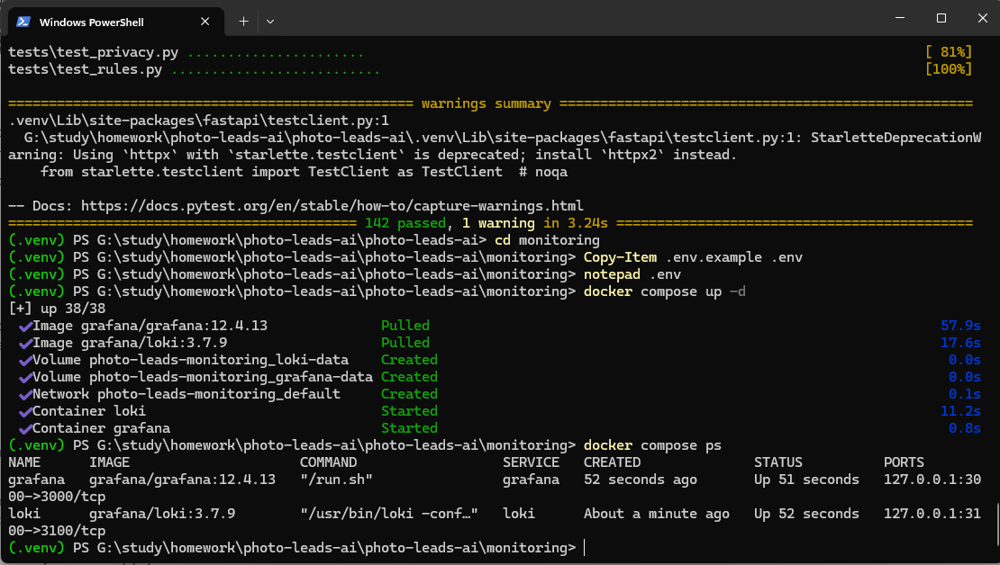
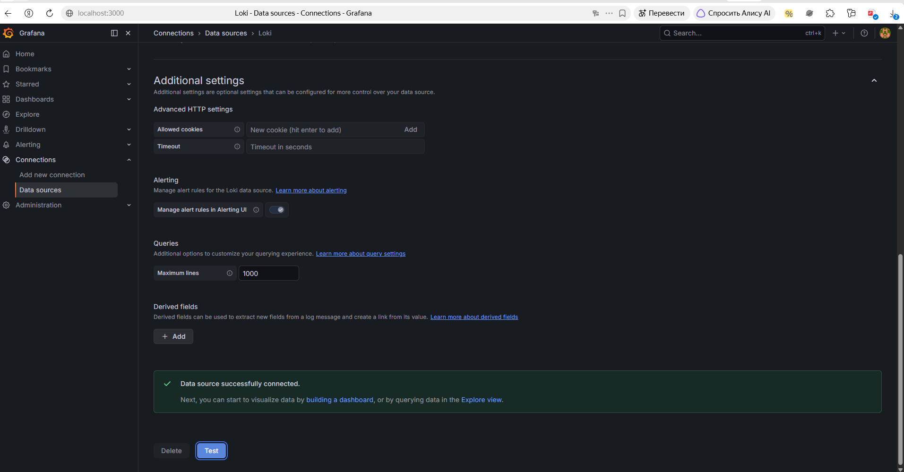
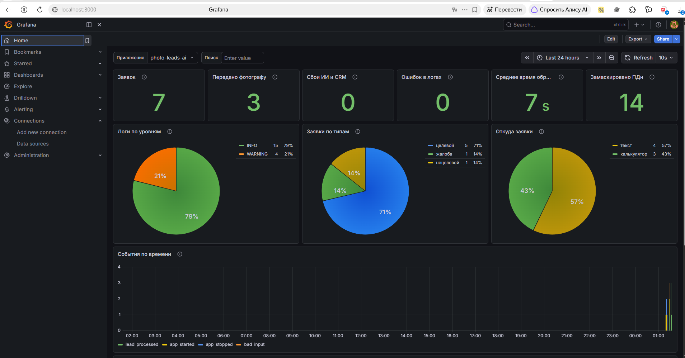
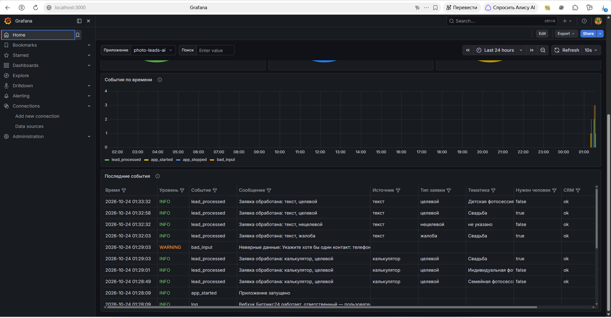
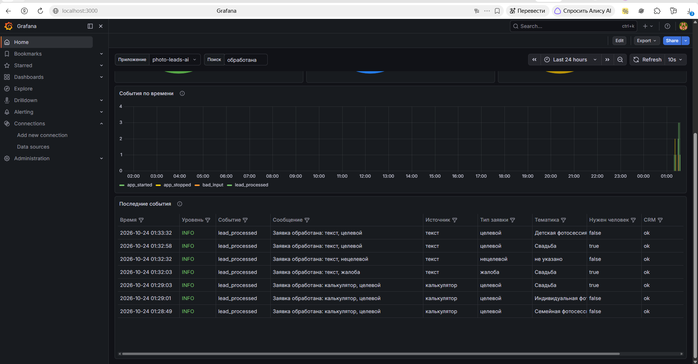

# VPe05. Мониторинг и логирование (Loki + Grafana) — отчёт по ДЗ

| | |
|---|---|
| Курс | «Профессия вайб-кодер», модуль 6 «Серверное развёртывание» |
| Урок | VPe05. Кейс 2: Мониторинг и логирование (Loki + Grafana) |
| Проект | [photographer-leads-ai-bitrix24](https://github.com/JaneEva08/photographer-leads-ai-bitrix24) — ИИ-разбор заявок частного фотографа (FastAPI + GigaChat + Битрикс24) |
| Где запущено | локально, Docker Desktop |
| Ветка и PR | `feature/monitoring-loki` |

Вместо учебного приложения из урока мониторинг подключён к моему рабочему проекту: сервису, который разбирает заявки фотографа нейросетью и заводит лиды в Битрикс24. Для такого сервиса мониторинг — не учебная игрушка: фотографу важно знать, сколько заявок пришло, сколько ушло ему лично и не отвалились ли GigaChat или CRM.

---

## Часть 1. Стек и источник данных

Файлы — папка [`monitoring/`](monitoring):

| Файл | Что делает |
|---|---|
| `docker-compose.yml` | два сервиса, `loki` (3.7.9) и `grafana` (12.4.13), версии закреплены |
| `loki/config.yaml` | Loki в режиме «всё в одном», хранение на диске, логи живут 14 дней |
| `grafana/provisioning/datasources/loki.yaml` | источник Loki (`http://loki:3100`) подключается сам при запуске |
| `grafana/provisioning/dashboards/dashboards.yaml` + `grafana/dashboards/photo-leads.json` | дашборд загружается сам, руками ничего собирать не нужно |
| `.env.example` | пароль администратора Grafana — в `.env`, не в compose |

```bash
cd monitoring
cp .env.example .env      # задать GRAFANA_ADMIN_PASSWORD
docker compose up -d
docker compose ps         # loki и grafana — running
```



Источник Loki: Connections → Data sources → Loki → **Test** — «Data source successfully connected». Кнопка называется Test, а не Save & test: источник подключён из файла настроек и в интерфейсе не редактируется, сохранять нечего.



## Часть 2. Дашборд

Дашборд «Заявки фотографа — мониторинг», обновление каждые 10 секунд, переменные «Приложение» (`$app`) и «Поиск» (`$search`).

| Панель | Запрос LogQL |
|---|---|
| **Таблица последних событий** (по метке `app`) | `{app="$app"} \|= "$search" \| json \| line_format "{{.msg}}"` |
| **Круговая: логи по уровням** | `sum by (level) (count_over_time({app="$app"}[$__range]))` |
| Круговая: заявки по типам | `sum by (lead_type) (count_over_time({app="$app", event="lead_processed"} \| json [$__range]))` |
| Круговая: откуда заявки | `sum by (source) (...)` — калькулятор или текст |
| Плитки: заявок, передано фотографу, сбои ИИ и CRM, ошибки, среднее время обработки, замаскировано ПДн | `count_over_time`, `avg_over_time ... unwrap ms`, `sum_over_time ... unwrap pii_masked` |
| События по времени | `sum by (event) (count_over_time({app="$app", event!="log"}[$__interval]))` |



Прогон 24.10.2026 на настоящих GigaChat и Битрикс24: 3 заявки из калькулятора, 4 тестовые заявки текстом из рабочего места фотографа и одна попытка отправить форму без контактов. Дашборд показал 7 заявок, 3 из них переданы фотографу (жалоба и две свадьбы, одна на занятую дату), 0 сбоев ИИ и CRM, среднее время обработки 7 секунд — почти всё время уходит на ответ GigaChat. До отправки в нейросеть анонимизатор заменил метками 14 персональных данных.



В таблице нет ни одного имени, телефона или email, хотя заявка «проверка анонимизатора» (строка «Детская фотосессия») ими заполнена: в Loki уходят только категории.

## Часть 3. Отправка логов из приложения

Функция отправки в Loki сделана как обработчик стандартного `logging` — [`app/loki.py`](app/loki.py). `POST /loki/api/v1/push`, структура `streams → stream (метки) → values [время в наносекундах, сообщение]`, как в уроке. Вызывать её в каждом эндпоинте не нужно: всё, что приложение пишет в лог, попадает в Loki. Бизнес-события пишутся функцией `log_event`:

```python
log_event(log, "lead_processed", "Заявка обработана: калькулятор, целевой",
          source="калькулятор", lead_type="целевой", needs_human=False, crm="ok", ms=840)
```

Подключение — одна переменная в `.env`: `LOKI_URL=http://localhost:3100/loki/api/v1/push`. Пусто — приложение работает как раньше.

Поиск по логам: в поле «Поиск» введено `обработана` — в таблице остались только обработанные заявки из калькулятора и рабочего места.



---

## Чем решение отличается от урока

Урок показывает принцип; для сервиса, который принимает заявки клиентов, часть решений пришлось сделать иначе.

| В уроке | Проблема | Как сделано |
|---|---|---|
| `requests.post` в каждом эндпоинте, без таймаута | Loki упал или тормозит — висит сайт и заявки клиентов | фоновый поток, пачки раз в секунду, таймаут 3 с; Loki недоступен — приложение работает, в консоли предупреждение |
| `def send_log_to_loki(self, message, ...)` вне класса | при вызове `send_log_to_loki("текст", "app", "INFO")` текст попадает в `self`, а в сообщение — `"app"` | обработчик `logging`, отдельная функция не нужна |
| пароль `admin/admin` прямо в compose, порты 3000 и 3100 открыты всем | любой может зайти в Grafana и писать в Loki | пароль из `monitoring/.env`, порты только на `127.0.0.1` |
| монтируются `loki-config.yml` и `datasources.json`, а созданы `loki-config.yaml` и `grafana-datasource.json` | Docker создаёт пустую папку вместо файла, настройки молча не применяются | имена сверены, источник и дашборд подключаются автоматически |
| папка `./loki:/loki` | образ Loki работает не от root и часто не может писать в папку хоста | именованные тома |
| круговая диаграмма: `\| logfmt \| level != ""` и `[$__interval]` | сообщения не в logfmt, а `level` и так метка; с `$__interval` пирог показывает только последний интервал | `sum by (level) (count_over_time(...[$__range]))`, запрос Instant |
| «нет labels» лечится удалением `networks` | причина была в `localhost` вместо адреса Loki у отправителя | сеть compose оставлена, адрес Loki — в `LOKI_URL` |
| `"environment": dict(os.environ)` в ответе главной страницы | наружу утекают токены и ключи | в проекте такого эндпоинта нет |

## Персональные данные (152-ФЗ)

Логи — тоже хранилище данных, поэтому:
- в Loki не уходят тексты заявок, имена и контакты: событие заявки содержит только тип, тематику, источник, статус CRM, время обработки и число замаскированных ПДн;
- телефоны и email в любой строке лога дополнительно маскируются перед отправкой (проверено тестом);
- логи `uvicorn.access` (IP посетителей) в Loki не отправляются;
- найдено при запуске: библиотека httpx печатала в консоль адрес вебхука Битрикс24 вместе с секретным ключом. Её логи приглушены до уровня WARNING — на сервере они попали бы в `docker logs`;
- Loki и Grafana не передают статистику использования в Grafana Labs;
- логи хранятся 14 дней и удаляются сами.

## Тесты

`pytest` — 143 теста (14 новых в `tests/test_loki.py`): формат запроса к Loki, группировка по меткам, маскировка телефонов и email, приложение не ждёт Loki и не падает при его недоступности или ответе 400, переполненная очередь не блокирует запросы, событие заявки не содержит персональных данных.

## Где это пригодится

Для лендинга стек избыточен. Он нужен, когда у заказчика или у меня несколько сервисов на одном сервере: один Grafana на все проекты, метка `app` разделяет их на дашборде. Для заказчиков — доп. услуга «дашборд заявок и ошибок» к ботам и сервисам с ИИ и CRM.
